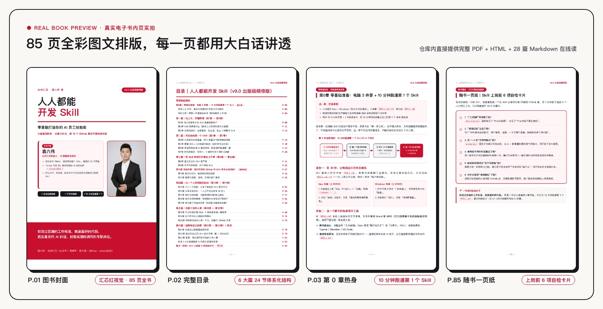
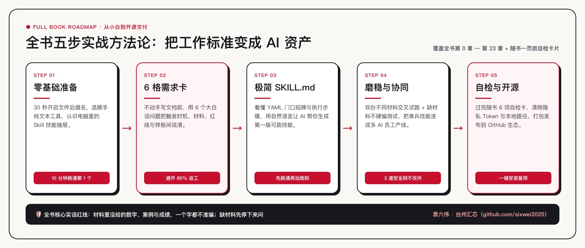

<div align="center">


# 《人人都能开发 Skill》

### 零基础打造你的 AI 员工技能库 · 85 页全彩图文全书免费开源（附在线章节 + 实战模板）

[](https://github.com/sixwei2025/everyone-can-build-skills)
[](book/人人都能开发Skill.pdf)
[-B45309?style=flat-square)](CHANGELOG.md)
[](LICENSE)

> 🔴 **作者：袁六伟 · 台州汇芯**｜一人 AI 公司创业者，学员 7000+，服务商单客户 100+（覆盖近 20 个行业），得到 / 华为分享老师  
> 📮 更多 AI 工具实测与自动化实战，关注 **公众号 / 视频号：袁六伟**

```bash
# 方式一：把本书方法论装进你的 AI 助手（支持 Codex / WorkBuddy / Antigravity）
npx skills add sixwei2025/everyone-can-build-skills

# 方式二：克隆完整电子书（含 PDF、HTML 与 28 篇 Markdown 章节）
git clone https://github.com/sixwei2025/everyone-can-build-skills.git
```

[📖 下载完整 PDF](book/人人都能开发Skill.pdf) · [📚 在线目录直达](#二全书完整目录点击即可在线阅读) · [🧭 五步方法论](#三全书五步实战方法论与随书工具箱) · [🧰 随书模板](#四仓库目录与开源说明) · [🌟 开源生态](#五关于作者与汇芯开源生态矩阵)

</div>

---

## 新手 30 秒安装：把链接发给 AI（或直接下载整本书）

如果你不想看命令行，打开 **Codex、WorkBuddy** 或其他支持读取仓库并安装技能的 AI 智能体，直接把下面这段话发到对话框，让它把本书的「随书实战教练」装进你的电脑：

```text
帮我安装这个仓库里的技能：
https://github.com/sixwei2025/everyone-can-build-skills
```

安装后可以直接问 AI：「**这个技能怎么用？带我用 6 格需求卡设计一个最简单的 Skill。**」

- 📥 **离线完整阅读**：点击下载 [《人人都能开发 Skill》完整 PDF（85 页 / 9.6MB）](book/人人都能开发Skill.pdf) 或前往 [GitHub Releases](https://github.com/sixwei2025/everyone-can-build-skills/releases) 获取。
- 🌐 **网页直接阅读**：无需下载大文件，下方目录每章均可点击直接在 GitHub 网页在线阅读。

---

## 一、为什么写这本书？真书内页实拍

市面上的 AI 教程大多停留在「背几个提示词」或「写一堆程序员才看得懂的代码」，普通人看完依然不知道怎么把自己的行业经验封装成 **每天自动干活的 AI 专职岗位**。

| 维度 | 传统 AI 教程 | 《人人都能开发 Skill》全书做法 |
| :--- | :--- | :--- |
| **门槛要求** | 满屏黑框终端与代码术语，新手第一页就劝退 | **第 0 章 30 秒开启文件后缀名 + 10 分钟跑通第 1 个 Skill** |
| **表达方式** | 抽象概念堆砌，只讲「是什么」不讲「怎么做」 | **全篇大白话 + 大量直观配图 + 6 格需求卡填表即用** |
| **真实案例** | 虚构玩具 Demo，跑完一次就吃灰 | **直接拆解 16+ 已开源到 GitHub 的真实业务产线** |
| **稳定性把关** | 改一次新功能就改坏旧功能，缺材料还瞎编 | **双份不同材料交叉试跑 + 实话红线 + 上岗前 6 项自检卡片** |

<div align="center">
  
</div>

---

## 二、全书完整目录（点击即可在线阅读）

### 零基础起跑线
- [第0章 零基础准备：电脑 3 件事 + 10 分钟跑通第 1 个 Skill](chapters/00-第0章-零基础准备：电脑-3-件事-+-10-分钟跑通第-1-个-Skill.md)
- [前言｜AI 时代，真正拉开差距的不是会不会聊天](chapters/01-前言-AI-时代，真正拉开差距的不是会不会聊天.md)
- [开始之前｜带着一件事读这本书（附找按钮 4 步法）](chapters/02-开始之前-带着一件事读这本书.md)

### 第一篇｜先上手，再懂原理（第 1 章 — 第 3 章）
- [第1章 你已经拥有开发 Skill 最重要的资产](chapters/03-第1章-你已经拥有开发-Skill-最重要的资产.md)
- [第2章 Skill 究竟是什么（新员工入职资料袋大白话版）](chapters/04-第2章-Skill-究竟是什么.md)
- [第3章 先用现成的：去哪里找、怎么装、怎么 3 眼挑对 Skill](chapters/05-第3章-先用现成的：去哪里找、怎么装、怎么用.md)

### 第二篇｜开发你的第一个 Skill（第 4 章 — 第 7 章）
- [第4章 开发前的四步准备：用 6 格需求卡把经验说清楚](chapters/06-第4章-开发前的四步准备：用需求卡把经验说清楚.md)
- [第5章 看懂 SKILL.md 的基本组成（含好坏写法对照）](chapters/07-第5章-看懂-SKILL.md-的基本组成.md)
- [第6章 用自然语言请 AI 帮你开发：四步闭环跑通第一版](chapters/08-第6章-用自然语言请-AI-帮你开发.md)
- [第7章 把它改稳定，再交付：3 道安全网不改坏旧功能](chapters/09-第7章-把它改稳定，再交付.md)

### 第三篇｜把 Skill 用到你的真实工作里（第 8 章 — 第 12 章）
- [第8章 建立自己的 Skill 资产库](chapters/10-第8章-建立自己的-Skill-资产库.md)
- [第9章 写作与短视频：两个内容 Skill](chapters/11-第9章-写作与短视频：两个内容-Skill.md)
- [第10章 实战拆解：我们开源到 GitHub 的 Skill 是怎么炼成的？](chapters/12-第10章-实战拆解：我们开源到-GitHub-的-Skill-是怎么炼成的？.md)
- [第11章 培训与交付：做课程和陪跑服务](chapters/13-第11章-培训与交付：做课程和陪跑服务.md)
- [第12章 数据与客服：表格、文件和客户跟进](chapters/14-第12章-数据与客服：表格、文件和客户跟进.md)

### 第四篇｜从一个人用到组织起来（第 13 章 — 第 17 章）
- [第13章 不止一个技能：让多个岗位的 Skill 配合干活](chapters/15-第13章-不止一个技能：让多个岗位的-Skill-配合干活.md)
- [第14章 从单兵到团队：一人公司怎么搭多 AI 员工](chapters/16-第14章-从单兵到团队：一人公司怎么搭多-AI-员工.md)
- [第15章 定时与自动跑：让固定动作按时自己启动](chapters/17-第15章-定时与自动跑：让固定动作按时自己启动.md)
- [第16章 知识与资料整理：把散落的文件变成可用资产](chapters/18-第16章-知识与资料整理：把散落的文件变成可用资产.md)
- [第17章 把日常工作做成系统（附团队防翻车急救箱）](chapters/19-第17章-把日常工作做成系统.md)

### 第五篇｜给能干活的人看（第 18 章 — 第 20 章）
- [第18章 什么叫高价值 Skill：5 级质量阶梯一眼看清](chapters/20-第18章-什么叫高价值-Skill：5-级质量阶梯一眼看清.md)
- [第19章 在不同平台上都能用得顺手](chapters/21-第19章-在不同平台上都能用得顺手.md)
- [第20章 把技能交给别人用：打包、脱敏与 GitHub 开源](chapters/22-第20章-把技能交给别人用：打包、脱敏与-GitHub-开源.md)

### 第六篇｜回到你自己的事（第 21 章 — 第 23 章）+ 附录
- [第21章 先做自己能看懂结果的事](chapters/23-第21章-先做自己能看懂结果的事.md)
- [第22章 建立你自己的 Skill 迭代节奏（附 7 天行动表）](chapters/24-第22章-建立你自己的-Skill-迭代节奏.md)
- [第23章 收尾：现在就可以开始的三件小事](chapters/25-第23章-收尾：现在就可以开始的三件小事.md)
- [附录｜大白话速查表与开源生态延伸阅读](chapters/26-附录-大白话速查表与开源生态延伸阅读.md)
- [随书一页纸｜Skill 上岗前 6 项自检卡片](chapters/27-随书一页纸-Skill-上岗前-6-项自检卡片.md)

---

## 三、全书五步实战方法论与随书工具箱

<div align="center">
  
</div>

随书为你准备了 3 份拿来即用的纯文本模板（位于 `templates/` 目录）：
1. **[极简入门模板 `templates/SKILL.md`](templates/SKILL.md)**：照抄即可 10 分钟跑通你的第一个技能。
2. **[开发前 6 格需求卡 `templates/需求卡模板.md`](templates/需求卡模板.md)**：写技能前花 3 分钟填好 6 个格子，避开 80% 返工。
3. **[上岗前 6 项自检卡片 `templates/上岗前6项自检卡片.md`](templates/上岗前6项自检卡片.md)**：可打印贴在电脑旁，上线/开源前 1 分钟打勾核验，避开 95% 翻车。

---

## 四、仓库目录与开源说明

```text
everyone-can-build-skills/
├── README.md                              # 全书开源总览与在线目录索引
├── SKILL.md                               # 随书实战教练技能（支持 npx skills add 一键安装）
├── LICENSE                                # MIT 开源协议
├── CHANGELOG.md                           # 版本更新日志
├── book/
│   ├── 人人都能开发Skill.pdf                # 85 页全彩图文完整电子书（推荐下载）
│   └── 人人都能开发Skill.html               # 浏览器离线阅读版
├── chapters/                              # 28 篇结构化 Markdown 章节（GitHub 直接在线读）
├── templates/                             # 随书配套模板（SKILL.md / 6 格需求卡 / 6 项自检卡）
└── assets/showcase/                       # 全书可视化展示横幅、路线图与内页画廊
```

> **开源与分享约定**：本项目采用 [MIT 协议](LICENSE) 免费开源。欢迎个人学习、团队内训、转发分享或基于随书模板二次开发，对外引用或二次分发时请保留 **「袁六伟 · 台州汇芯（公众号 / 视频号：袁六伟）」** 原作者署名。

---

## 五、关于作者与汇芯开源生态矩阵

- **作者**：**袁六伟 · 台州汇芯创始人**（一人 AI 公司实战派，累计带出实战学员 **7000+**，服务企业商单客户 **100+**，覆盖近 **20** 个行业，得到 / 华为分享老师）
- **关注交流**：微信公众号 / 视频号搜 **「袁六伟」** ｜ GitHub 主页：[https://github.com/sixwei2025](https://github.com/sixwei2025)

| 分类 | 开源仓库 | 一句话定位 |
| :--- | :--- | :--- |
| **方法论与知识** | [**everyone-can-build-skills**](https://github.com/sixwei2025/everyone-can-build-skills) | **本书《人人都能开发 Skill》全书开源（PDF + 28 篇在线章节 + 模板）** |
| | [yuanliuwei-ai-skills](https://github.com/sixwei2025/yuanliuwei-ai-skills) | 一人 AI 公司实战方法论：PACT 72 小时验证器 + 10 大业务模块 |
| | [book-skill](https://github.com/sixwei2025/book-skill) | 把整本书蒸馏成可执行的决策与工具框架 |
| | [huangdi-skill](https://github.com/sixwei2025/huangdi-skill) | 一手史料与经典决策框架研究技能 |
| **公众号全自动** | [workbuddy-wechat-autopilot](https://github.com/sixwei2025/workbuddy-wechat-autopilot) | 公众号九步闭环全自动写作与草稿箱直投总控 |
| | [ai-tool-review-wechat-skill](https://github.com/sixwei2025/ai-tool-review-wechat-skill) | AI 工具真跑实测、真实截图配图与评测长文产线 |
| | [wechat-cover-skill](https://github.com/sixwei2025/wechat-cover-skill) | 汇芯红 6 大杂志风封面引擎与防压脸自动校验 |
| | [gzh-million-layout-skill](https://github.com/sixwei2025/gzh-million-layout-skill) | 6 套百万阅读公众号 100% 内联 CSS 零乱码排版骨架 |
| | [hit-title-expert-skill](https://github.com/sixwei2025/hit-title-expert-skill) | 高浓缩爆款短标题生成与去套路把关 |
| **全自动短视频** | [auto-tutorial-skill](https://github.com/sixwei2025/auto-tutorial-skill) | 软件实操自动推拉运镜 + 红框聚焦 + Voicebox 原声配音 |
| | [talking-head-video-skill](https://github.com/sixwei2025/talking-head-video-skill) | 真人口播短视频自动剪辑、BGM 侧链混音与 3:4 封面首帧内嵌 |
| | [3d-map-video-skill](https://github.com/sixwei2025/3d-map-video-skill) | 3D 地形与历史战役推演可视化短视频产线 |
| | [dark-infographic-video-skill](https://github.com/sixwei2025/dark-infographic-video-skill) | 暗黑流光数据图表与财经科技科普视频产线 |
| | [psych-kepu-video-skill](https://github.com/sixwei2025/psych-kepu-video-skill) | 心理科普动效短视频全自动生成流水线 |
| **团队基建与工具** | [local-video-hub](https://github.com/sixwei2025/local-video-hub) | 多 AI 员工统一交片查重的本地视频管理中心 |
| | [huixin-skills-manager](https://github.com/sixwei2025/huixin-skills-manager) | 汇芯技能管家：跨平台 Skill 一键同步与可视管理桌面端 |
| | [huixin-token-manager](https://github.com/sixwei2025/huixin-token-manager) | 汇芯 Token 管家：多平台 API 额度与密钥安全管理 |
| | [huixin-content-manager](https://github.com/sixwei2025/huixin-content-manager) | 汇芯内容管家：全渠道内容资产归档与状态流转 |
| | [antigravity-zh-solution](https://github.com/sixwei2025/antigravity-zh-solution) | Antigravity 中文界面适配与本土化增强方案 |
| | [sunrise-tracker](https://github.com/sixwei2025/sunrise-tracker) | 自动化追踪与定时任务实战工具 |
